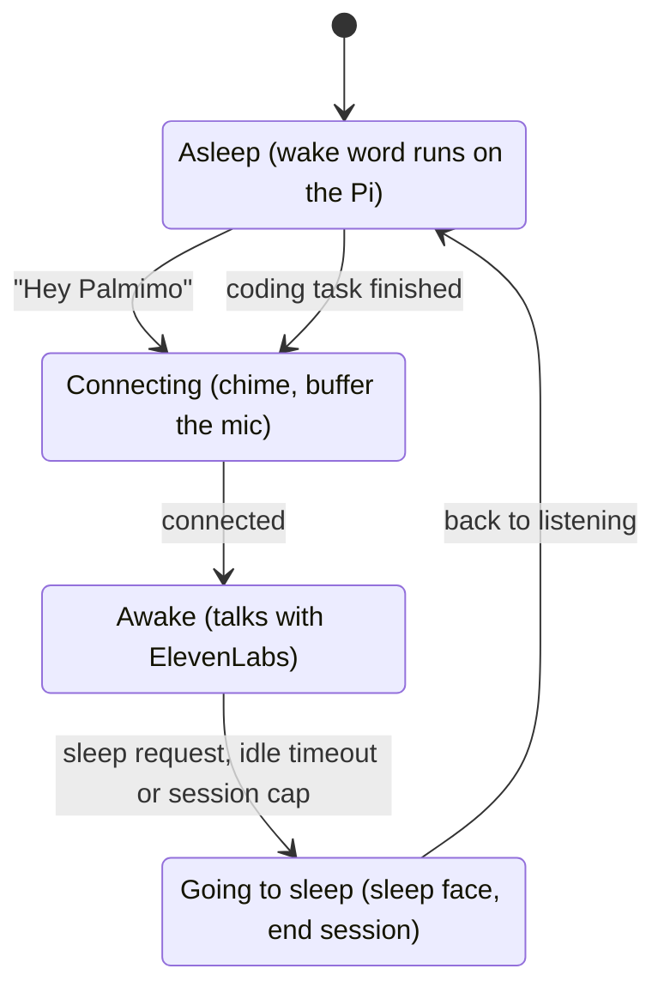
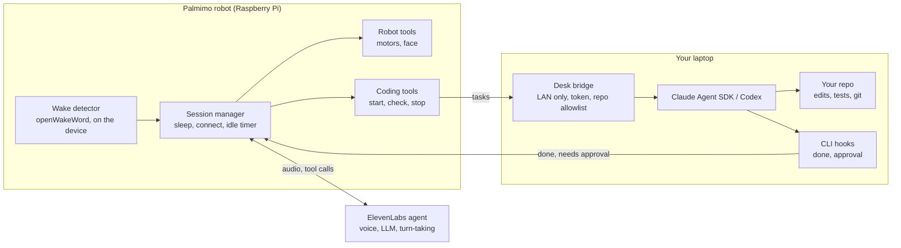

# Palmimo: Wake Word and Desk Coding Assistant

2026-10-30 · Jamie

## Summary

Palmimo sleeps by default and only talks to ElevenLabs after someone says **"Hey Palmimo"**. It goes back to sleep when told to, or after a stretch of silence. A second mode turns it into a desk coding assistant: you speak a task, and Claude Code or Codex does the work on your laptop.

Today one app run is one open conversation. The robot hears everything in the room, and it fills silence with "are you still there?". Wake-word gating fixes both problems. It also means no audio leaves the robot and no paid session stays open while nobody is talking to it.

## Goals and non-goals

**Goals**

- No mic audio leaves the robot until the wake phrase is heard. Wake detection runs on the Pi.yeah
- "Hey Palmimo" opens a conversation within about 1 second, with a face change and chime the moment it is heard.
- The conversation ends on a spoken sleep request, after an idle timeout, or at a hard session cap.
- Palmimo can hand a spoken coding task to Claude Code or Codex running in a repo on your laptop.
- When a coding task finishes or needs your input, Palmimo says so in one or two sentences, even if it was asleep.

**Non-goals for v1**

- Recognising who is speaking.
- Reading code or diffs aloud. Details stay in the terminal and in git.
- Running the coding agents on the Pi itself.
- Approving risky coding actions by voice. Approvals stay on the laptop screen.

## Feature 1: wake word and sleep

The app becomes long-running. It cycles through four states, and only the Awake state streams audio to ElevenLabs.

A finished coding task can also wake Palmimo, so it can announce the result (Feature 2).

**Waking**

- **Detector:** openWakeWord runs on the Pi's CPU, is open source, and supports custom phrases trained from synthetic speech. Porcupine (Picovoice) is the fallback; it is quick to set up but needs an access key and has licence limits.
- **Phrase:** "Hey Palmimo" as the main phrase. A single word like "Palmimo" triggers by accident more often.
- **Say it in one breath:** Keep the last 2 seconds of mic audio and send it once the WebSocket opens. Then "Hey Palmimo, what's the weather?" works without a pause.
- **Feedback:** Show the awake face and play a short chime as soon as the phrase is heard, before the connection is up. Connecting takes about 0.5 seconds in the current logs.

**Sleeping**

- **Sleep request:** A new `go_to_sleep` client tool. The agent calls it for "go to sleep", "that's all" or "bye", so phrasing doesn't need to be exact. The robot then plays its sleep face and closes the session.
- **Idle timeout:** No user speech for `idle_timeout_secs` (45 s proposed) closes the session. The clock restarts on every user transcript and pauses while a tool is running.
- **Session cap:** `max_session_secs` closes even an active conversation, as a cost guard. ElevenLabs' own `silence_end_call_timeout` stays on as a server-side backstop.
- The `skip_turn` and 30-second turn timeout changes stay. They keep Palmimo quiet during pauses while it is awake.

**Process changes**

- One app run no longer equals one conversation. `main.py` loops: sleep, wake, converse, sleep.
- Robot tools are synced with ElevenLabs once at start-up, not on every wake.
- Stopping the app from the Portal still ends any open conversation and parks the robot.

## Feature 2: desk coding assistant

Palmimo is the voice and body; the coding agent runs on your laptop, where the repo and your editor already are. A small **desk bridge** process on the laptop connects the two in both directions.

**Voice to agent.** The ElevenLabs agent gets a few new client tools. Palmimo forwards each call to the bridge over the local network:

| Tool | What the bridge does |
| --- | --- |
| `start_coding_task(task, repo, agent)` | Starts a session in the named repo through the Claude Agent SDK, or the Codex runner (see below) |
| `coding_task_status()` | Returns the latest progress line and elapsed time |
| `continue_coding_task(message)` | Sends a follow-up into the same session (resumed session or thread) |
| `cancel_coding_task()` | Stops the running session |

**Agent to voice.** The bridge already sees every progress event from the SDK, so it knows when a task ends or waits for approval. For sessions you start yourself in a terminal, Claude Code hooks (`Stop`, `Notification`) and Codex's notify setting call the bridge too. Palmimo shows a face, plays a chime, and speaks a one-line summary. If it was asleep, it opens a short conversation that starts with that summary, so you can reply straight away.

**How it talks about code**

- One or two sentences per update, such as "Done. Tests pass, three files changed."
- It never reads code, paths or diffs aloud.
- While a task runs, it shows a "thinking" face instead of narrating each step.
- Long tasks don't keep the conversation open. Palmimo goes back to sleep and wakes itself when the bridge reports back.

**Safety**

- The bridge only accepts repos on an allowlist in its own config file.
- Both agents keep their normal permission prompts, answered on the laptop screen. Anyone in the room can speak, so voice must not be able to approve file writes or shell commands.
- The bridge listens on the local network only and needs a shared token from the robot.

## Connecting to the coding agents

There are four ways to drive Claude Code and Codex from our own code. The bridge uses the official SDKs; the rest are fallbacks or references.

| Option | Claude Code | Codex | Use in this project |
| --- | --- | --- | --- |
| Official SDK | Claude Agent SDK (Python, TypeScript): sessions, streaming events, permission callbacks | [Codex SDK](https://developers.openai.com/codex/sdk.md) (`@openai/codex-sdk`): `startThread()`, `resumeThread()`; threads saved in `~/.codex/sessions` | **Chosen for the bridge.** Claude Agent SDK in Python for v1 |
| Headless CLI | `claude -p "<task>" --output-format stream-json`, `--resume` | `codex exec --json "<task>"`, `codex exec resume` | Codex runner in v1, until the bridge supports Codex through an SDK or ACP |
| MCP server | `claude mcp serve` exposes Claude Code's tools over stdio ([guide](https://www.ksred.com/claude-code-as-an-mcp-server-an-interesting-capability-worth-understanding/)) | `codex mcp-server`, with a start tool and a reply tool; experimental, sessions need long timeouts ([guide](https://codex.danielvaughan.com/2026/05/18/codex-cli-as-mcp-server-exposing-agent-capabilities-agents-sdk-multi-agent-delegation/)) | Not needed; the SDK gives the bridge more control over progress and approvals |
| Agent Client Protocol (ACP) | [claude-code-acp](https://github.com/dweinstein/claude-code-acp) adapter, built on the Claude Agent SDK | [codex-acp](https://github.com/Finityno/codex-acp) adapter | Option for v1.1: one protocol for both agents instead of two runners ([Zed docs](https://zed.dev/docs/ai/external-agents?highlight=codex)) |

**Prior art to study before building the bridge**

- [Happy](https://github.com/slopus/happy) (MIT): controls Claude Code and Codex from a phone, with push notifications and voice input. Closest to Palmimo's desk mode, especially how it handles approvals and notifications.
- [HAPI](https://awesome.ecosyste.ms/projects/github.com%2Ftiann%2Fhapi): runs Claude Code, Codex, Gemini or OpenCode locally and controls them from a web app or Telegram.
- [Omnara](https://apps.apple.com/app/id6748426727): a commercial mobile app for Claude Code and Codex; its early open-source version is no longer maintained ([comparison](https://seawork.ai/en/blogs/omnara-vs-happy-vs-seawork/)).

Most of these sources are third-party guides. Check command flags and package names against each project's own docs before building.

## Architecture

A new session manager on the robot owns the sleep and wake cycle. Coding work crosses the local network to a bridge on the laptop.

The robot only talks to ElevenLabs while awake. The laptop calls back into the session manager when a task finishes or needs approval.

| File | Where | What it holds |
| --- | --- | --- |
| `main.py` | robot | Start-up, settings, the long-running loop |
| `wake.py` (new) | robot | Mic reader, openWakeWord detector, 2-second pre-roll buffer |
| `session.py` (new) | robot | The four states, idle timer, session cap; the WebSocket code moved from `main.py` |
| `robot_tools.py` | robot | Existing tools plus `go_to_sleep` |
| `coding_tools.py` (new) | robot | Client tools that forward to the desk bridge |
| `desk_bridge/` (new) | laptop | A small HTTP server that runs one agent session per task, streams progress, and receives hook calls |

## Settings in palmimo.toml

New Portal settings, alongside the existing `agent_id`, speaker, mic and volume. The defaults are starting points to tune on the robot.

| Setting | Type | Proposed default | Purpose |
| --- | --- | --- | --- |
| `wake_model` | string | `hey_palmimo` | Which wake-word model file to load |
| `wake_threshold` | float | 0.5 | Detector score needed to wake; raise it if it wakes by accident |
| `idle_timeout_secs` | float | 45 | Seconds without user speech before it sleeps |
| `max_session_secs` | float | 600 | Hard cap on one conversation, as a cost guard |
| `desk_bridge_url` | string | empty | Laptop bridge address, such as `http://192.168.1.20:8765`; empty turns coding mode off |
| `coding_agent` | string | `claude` | Default agent: `claude` or `codex` |
| `DESK_BRIDGE_TOKEN` | env | none | Shared secret the bridge checks on every call |

Sleep phrases aren't a setting. The agent decides when a request means "sleep" and calls the `go_to_sleep` tool. The repo allowlist lives in the bridge's config on the laptop, not on the robot.

## Risks and open questions

| Risk | Impact | Mitigation |
| --- | --- | --- |
| False wakes from TV, video calls or people saying the name | Robot interrupts the room; paid sessions open | Use "Hey Palmimo" rather than "Palmimo" alone; tune `wake_threshold`; the idle timeout closes stray sessions fast |
| Missed wakes from accents or distance | Users repeat themselves and give up | Train the custom model on varied synthetic voices; log detector scores to tune the threshold |
| No echo cancellation on the current mic | Robot's own voice can trigger a wake or an interruption | Pause wake detection while the speaker plays; keep the existing mic mute |
| Pi CPU load from the wake model plus motors and display | Choppy audio (`underrun` lines already show in logs) | Measure CPU with all parts running before M1 ships |
| Someone else in the room speaks a coding task | Unwanted code changes | Repo allowlist; approvals on screen only; the bridge never runs with permission prompts off |
| SDK, CLI flags and hook formats change between versions | Bridge breaks after an update | Pin SDK and CLI versions in the bridge; one integration test per agent |

**Open questions**

- [ ] Does the agent allow a `first_message` override for self-wake announcements? It has to be turned on in the agent's security settings.
- [ ] Should Codex ship in v1, or Claude Code first and Codex in v1.1?
- [ ] Should the bridge use ACP from the start, so both agents share one code path?
- [ ] Is 45 seconds the right idle timeout once real desk use is observed?
- [ ] Is "go to sleep" enough, or do people also expect "stop" and "thanks, that's all"?

## Milestones and test plan

Build in four steps; each one is usable on its own.

1. **M1: wake and sleep.** A long-running app with the sleep/listen/talk loop, the stock "hey jarvis" openWakeWord model as a stand-in, the idle timeout and the `go_to_sleep` tool.
    - Done when: 30 minutes beside a running TV with zero false wakes, and every session closes by itself.
2. **M2: custom "Hey Palmimo" model.** Train it, replace the stand-in, and tune the threshold from logged scores.
    - Done when: at least 9 out of 10 wakes from 2 m away, by three different people.
3. **M3: desk bridge with Claude Code.** The bridge on the Claude Agent SDK, the four coding tools, and the `Stop` and `Notification` hooks calling back to the robot.
    - Done when: a spoken "add a test for X" ends with a commit-ready change and a spoken summary.
4. **M4: Codex and self-wake.** Add the Codex runner (or ACP) and self-wake announcements when a long task finishes while Palmimo sleeps.

**Test checklist**

- [ ] Asleep, no audio reaches ElevenLabs: confirm in the logs and the ElevenLabs conversation history.
- [ ] "Hey Palmimo, what time is it?" in one breath gets an answer, with no second prompt needed.
- [ ] Two people talking nearby for 5 minutes cause no reply and no wake.
- [ ] Session closes after `idle_timeout_secs`, and the face shows sleep.
- [ ] Stopping the app from the Portal while awake ends the conversation and parks the robot.
- [ ] A coding task in a repo not on the allowlist is refused with a spoken reason.
- [ ] A 10-minute coding task: Palmimo sleeps meanwhile, then wakes and announces the result.

## Sources and prior art

- [HeyRobo for Reachy Mini](https://adriantam-hey-robo.static.hf.space/index.html): a wake gate on the device; no audio goes to OpenAI in standby.
- [Reachy Mini conversation app](https://github.com/pollen-robotics/reachy_mini_conversation_app): the closest open-source robot app; it supports OpenAI, Gemini and Hugging Face voice services.
- [OpenLexaPi](https://github.com/ARDings/OpenLexaPi): Raspberry Pi, Porcupine wake word, robot face.
- [AI Companion Robot](https://awesome.ecosyste.ms/projects/github.com%2Fbasst314%2Fai-companion-robot): a follow-up listening window after each reply.
- [Gemini Live proactive audio](https://cloud.google.com/vertex-ai/generative-ai/docs/live-api/proactive-audio?hl=ja): an alternative where the model ignores speech not meant for it.
- [Speak or Stay Silent (2026)](https://arxiv.org/abs/2603.11409): research on when a voice assistant should reply in group conversation.
- [Agent Client Protocol explainer](https://www.morphllm.com/agent-client-protocol), [Happy write-up](https://dev.to/_53fb7c03dd741a6124e4e/happy-the-open-source-app-that-puts-claude-code-in-your-pocket-7i2), [Codex SDK streaming guide](https://codex.danielvaughan.com/2026/04/08/codex-typescript-sdk-streaming-multimodal/).
